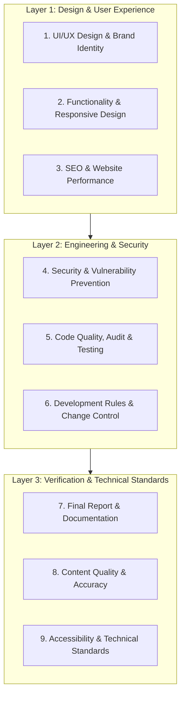

# Master Prompt: Website Audit, Improvement & Hardening Framework

Use this structured prompt when conducting a complete end-to-end audit, visual refactoring, performance optimization, and security hardening of a modern web application (e.g., Vite, Next.js, or React).

---

## Architecture Overview

---

# LAYER 1: DESIGN & USER EXPERIENCE

## Category 1: UI/UX Design & Brand Identity
*Goal: Establish a cohesive, authentic visual language and avoid generic design clichés.*

1. **Avoid Generic AI Clichés**:
   - Eliminate unmotivated purple/violet glow gradients, neon mesh backgrounds, and robotic floating card patterns.
   - Replace generic stock illustrations with project-specific SVGs, high-quality vector iconography (`lucide-react`, Feather), or authentic custom brand assets.
2. **Color Palette & Contrast**:
   - Define a deliberate color hierarchy: primary brand color, dark neutral tones for text (`#0F172A`, `#1E293B`), light backgrounds (`#FFFFFF`, `#F8FAFC`), and an accent color used strictly for calls-to-action or status flags.
   - Ensure every text-to-background pairing strictly satisfies WCAG AA minimum contrast ratio ($4.5:1$ for normal text, $3:1$ for large text).
3. **Typography Hierarchy**:
   - Use a clear typographic scale with responsive font sizes, proportional line-heights ($1.4$–$1.6$ for body copy), and bounded letter spacing.
   - Limit font families to a maximum of 2 distinct typefaces (e.g., one geometric or modern sans for headings, one neutral legible sans for body).
4. **Restraint in Motion & Styling**:
   - Avoid excessive animations, bouncing hero elements, and decorative auto-rotating badges.
   - Keep transitions purposeful and fast ($150\text{ms}$–$250\text{ms}$, ease-out). Respect user preference for reduced motion (`prefers-reduced-motion`).
   - Use subtle, grounded drop-shadows with low opacity rather than heavy blurred dark shadows.

---

## Category 2: Website Functionality & Responsive Design
*Goal: Ensure seamless interaction, robust state management, and reliable layouts across all form factors.*

1. **Interactive Element Integrity**:
   - Verify every link, button, dropdown menu, modal, tab switcher, and drawer navigation works reliably without dead ends or broken event handlers.
   - All external anchor tags must include `target="_blank"` with `rel="noopener noreferrer"`.
2. **Comprehensive UI States**:
   - Implement explicit, polished UI states for every interactive component:
     - **Default / Hover / Focus / Active**: Visible interactive feedback.
     - **Loading State**: Inline spinners, disabled submit states, or skeleton screens to prevent double-submissions.
     - **Empty State**: Informative graphics and actionable guidance when lists or feeds are empty.
     - **Error State**: Friendly, actionable recovery messages instead of raw crash traces or blank views.
3. **Responsive Breakpoints & Overflow Prevention**:
   - Test layouts at standard viewport widths: Mobile ($360\text{px}$–$414\text{px}$), Tablet ($768\text{px}$–$834\text{px}$), Desktop ($1024\text{px}$–$1440\text{px}$), and Ultra-wide ($1920\text{px}+$).
   - Eliminate horizontal scrollbars (`overflow-x: hidden` / container constraints) caused by fixed-width containers or unpadded media.
   - Ensure form controls and bottom sheets remain fully usable with on-screen mobile keyboards.
4. **Keyboard Navigation & Traps**:
   - Ensure all interactive controls can be focused and triggered using `Tab`, `Enter`, and `Space`.
   - Modals and slide-out drawers must trap keyboard focus while open and release focus upon `Escape` or dismissal.

---

## Category 3: SEO & Website Performance
*Goal: Maximize crawlability, Core Web Vitals, and social discoverability.*

1. **Meta Tags & Heading Hierarchy**:
   - Provide unique, contextual `<title>` tags ($50$–$60$ characters) and `<meta name="description">` ($140$–$160$ characters) for every route.
   - Maintain a strict heading hierarchy: exactly one `<h1>` per view, logically followed by `<h2>`, `<h3>`, without skipping levels.
   - Include canonical link tags (`<link rel="canonical" href="...">`) to eliminate duplicate content indexing.
2. **Search Crawlers & Sitemaps**:
   - Configure a clean `robots.txt` specifying allowed crawl directories and pointing to the XML sitemap.
   - Generate a valid `sitemap.xml` listing all canonical, public-facing URLs with realistic update frequencies.
3. **Social Sharing Metadata (Open Graph & Twitter Cards)**:
   - Include complete `og:title`, `og:description`, `og:image`, `og:url`, and `og:type` tags.
   - Include corresponding `twitter:card` (typically `summary_large_image`), `twitter:title`, `twitter:description`, and `twitter:image`.
4. **Core Web Vitals & Asset Optimization**:
   - **LCP (Largest Contentful Paint)**: Preload key hero images/fonts; lazy-load non-critical off-screen assets.
   - **CLS (Cumulative Layout Shift)**: Explicitly specify `width` and `height` attributes on images, videos, and iframe embeds.
   - **FID / INP (Interactivity & Responsiveness)**: Split large JS bundles with dynamic imports (`React.lazy`, route-level code splitting) and minimize main-thread execution time.
   - Serve modern image formats (WebP/AVIF) with automated compression.

---

# LAYER 2: ENGINEERING & SECURITY

## Category 4: Security & Vulnerability Prevention
*Goal: Fortify authentication, data pipelines, network boundaries, and environment configurations.*

> [!IMPORTANT]
> Keep security audits strictly decoupled from visual or layout reviews. A polished UI does not guarantee a safe backend or secure client runtime.

1. **Secrets & Environment Variables**:
   - Never commit or expose private keys, API secrets, database passwords, or JWT secrets in client code or Git repositories.
   - Strictly separate public client variables (e.g., `VITE_PUBLIC_*` or `NEXT_PUBLIC_*`) from backend secrets (`process.env.*`).
   - Audit `.gitignore` to ensure `.env`, `.env.local`, and build credentials are permanently excluded.
2. **Authentication & Session Security**:
   - Transmit and store auth tokens exclusively in secure, `HttpOnly`, `SameSite=Lax` or `Strict` cookies (or ephemeral in-memory storage) to prevent token theft.
   - Validate token expiration and implement robust server-side revocation on logout.
3. **Input Validation & Injection Defense**:
   - Enforce server-side schema validation (e.g., Zod, Joi) on all inbound request bodies, query params, and route parameters.
   - Prevent SQL Injection using parameterized queries or ORMs with prepared statements.
   - Sanitize dynamic HTML rendering (avoid unescaped `dangerouslySetInnerHTML`) to prevent Cross-Site Scripting (XSS).
4. **API Security, Rate Limiting & CORS**:
   - Restrict CORS headers to explicitly whitelisted origin domains; never use open wildcards (`*`) for credentialed routes.
   - Apply rate limiting on sensitive endpoints (login, OTP dispatch, registration, search, and checkout).
5. **HTTP Security Headers**:
   - Enforce modern security headers in reverse proxy (Nginx/Cloudflare) or server middleware:
     - `Content-Security-Policy` (CSP)
     - `Strict-Transport-Security` (HSTS: `max-age=31536000; includeSubDomains; preload`)
     - `X-Frame-Options: DENY` or `SAMEORIGIN`
     - `X-Content-Type-Options: nosniff`
     - `Referrer-Policy: strict-origin-when-cross-origin`
6. **Dependencies & Database Access**:
   - Regularly run vulnerability scans (`npm audit`).
   - Restrict database user privileges to the least-privilege scope needed for application runtime.

---

## Category 5: Code Quality, Project Audit & Testing
*Goal: Ensure maintainability, architectural integrity, and automated regression safety.*

1. **Architecture Inspection**:
   - Inspect monorepo and folder structure to ensure separation of concerns between shared types, server controllers, and UI presentation components.
   - Eliminate cyclic imports and dead code.
2. **Issue Categorization & Prioritization**:
   - Group findings by severity:
     - **Critical / Blocker**: Security vulnerabilities, authentication bypass, data loss, runtime crash.
     - **High**: Broken primary flows (checkout, calling, login), significant performance drops.
     - **Medium**: Minor visual misalignments, missing error states, non-standard HTTP codes.
     - **Low / Enhancement**: Code cleanup, cosmetic refactoring, documentation updates.
3. **Static Analysis & Type Safety**:
   - Execute TypeScript compiler (`tsc --noEmit`) to verify 0 compilation errors across all packages.
   - Run linter (`eslint`) with zero tolerance for unhandled promises or unsafe type casting (`any`).
4. **Production Build & Runtime Verification**:
   - Confirm clean production builds (`npm run build`) without missing chunk warnings or unresolvable assets.
   - Inspect browser DevTools console to ensure zero uncaught errors, 404 assets, or hydration mismatches.

---

## Category 6: Development Rules & Change Management
*Goal: Preserve business logic, avoid risky regressions, and maintain strict change accountability.*

1. **Preserve Purpose & Core Functionality**:
   - Keep existing business features, database contracts, and user flows intact unless explicitly instructed to change them.
   - Preserve all existing code comments, docstrings, and license notices.
2. **Avoid Unnecessary Dependencies**:
   - Do not install heavy third-party libraries for simple utility functions that can be implemented cleanly with standard JavaScript/TypeScript.
3. **Safe Change Practices**:
   - Isolate refactorings into focused, verifiable changes rather than wholesale file rewrites.
   - Require explicit review and backup before running irreversible database migrations, clearing volumes, or altering authentication secrets.
4. **Integrity in Configuration**:
   - Never invent fictitious API endpoints, fake third-party credentials, or speculative configurations.
   - Clearly document assumptions and identify items requiring real production keys (e.g., payment gateways, SMS providers, RTC tokens).

---

# LAYER 3: VERIFICATION, CONTENT & STANDARDS

## Category 7: Final Report & Documentation
*Goal: Provide a transparent, auditable log of findings, changes made, and outstanding items.*

1. **Summary of Findings & Resolutions**:
   - Document all issues discovered during the audit and categorize the exact resolutions implemented.
2. **Security & Performance Remediation Log**:
   - List every security vulnerability patched, headers added, and bundle optimizations completed with before/after benchmarks.
3. **Test Execution & Verification Log**:
   - Report exact commands executed (`npm run build`, `tsc`, `lint`, end-to-end tests) and their terminal outputs.
4. **Operational & Manual Next Steps**:
   - Detail any production tasks requiring manual user action (e.g., DNS verification, adding live payment API keys in dashboard, SSL provisioning).

---

## Category 8: Content Quality & Accuracy
*Goal: Safeguard brand trust by maintaining genuine copy and eliminating artificial placeholders.*

1. **Eradicate Placeholder Content**:
   - Replace "Lorem ipsum", "John Doe", and test strings with contextually accurate, realistic content tailored to the brand.
2. **Preserve Genuine Brand Voice**:
   - Preserve existing approved company copy, product descriptions, legal disclaimers, and contact details.
   - Avoid fabricating fake customer testimonials, fabricated review metrics, or fictitious company milestones.
3. **Accurate Business & Policy Details**:
   - Ensure terms of service, refund policies, support emails, and company addresses match the legal entity accurately.

---

## Category 9: Accessibility & Technical Standards
*Goal: Guarantee universal accessibility and adherence to modern web standards.*

1. **WCAG 2.1 AA Compliance**:
   - Provide descriptive `alt` attributes for all informative images and mark purely decorative images with `alt=""`.
   - Ensure all form fields have explicitly associated `<label>` elements or accessible `aria-label` tags.
   - Provide visible focus rings for keyboard users (`focus-visible`).
2. **ARIA Roles & Semantic HTML**:
   - Use semantic HTML tags (`<nav>`, `<header>`, `<main>`, `<aside>`, `<footer>`, `<button>`, `<article>`) instead of nested `
` wrappers.
   - Use ARIA roles (`aria-expanded`, `aria-hidden`, `aria-live`) only when native semantic elements cannot satisfy the pattern.
3. **Standards-Compliant Deployment Architecture**:
   - Ensure routing behaves correctly for Single Page Applications (SPA fallback rewrites to `/index.html` on deep links).
   - Verify proper MIME types are sent by static file servers (especially `.js`, `.mjs`, `.css`, `.svg`, and `.woff2`).
