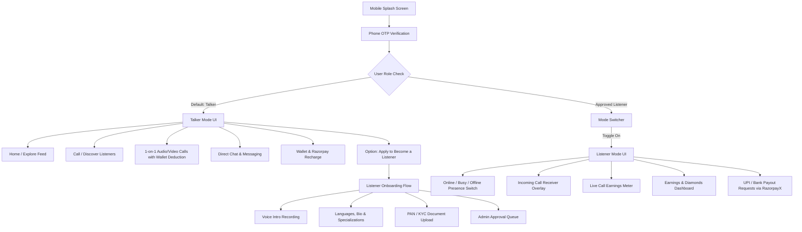

# Chatzie — Complete Master Architectural Plan & System Specification

---

## 1. Brand Identity & Visual Design System

* **Brand Name**: **Chatzie**
* **Icon / Logo**: Modern minimalist speech-bubble / chat wave vector emblem.
* **Core Value**: India's premier, professional voice & video connection platform connecting Talkers with verified Listeners.
* **Zero-Emoji Policy**: **No emojis anywhere in the app or dashboard.** All visual signifiers use clean, high-precision SVG/vector icons (`lucide-react-native`, `feather`, `material-icons`).

### Color Palette
| Token | Hex Code | Usage |
| :--- | :--- | :--- |
| **Primary Brand Blue** | `#1E40AF` / `#2563EB` | Header bars, primary CTA buttons, active tab indicators, branding |
| **Pure White** | `#FFFFFF` | Backgrounds, cards, elevated surfaces, clean negative space |
| **Accent Red** | `#DC2626` / `#EF4444` | End call buttons, unread notification dots, alert badges, critical actions |
| **Surface Slate / Neutral** | `#F8FAFC` / `#F1F5F9` | Screen canvas background, input field fills, inactive borders |
| **Text Dark Charcoal** | `#0F172A` | Primary typography, headings, labels |
| **Text Muted Slate** | `#64748B` | Subheadings, timestamps, secondary metadata |
| **Status Green** | `#16A34A` | Online presence rings, completed transaction badges |

---

## 2. Dual-Role Architecture (Talker Mode vs. Listener Mode)

Chatzie operates as a **single unified app** with clean role toggling:



### A. Talker (Caller) Experience
1. **Onboarding**: Phone OTP login, name, age, gender, preferred languages.
2. **Home Screen**:
   * Header with avatar greeting (`"Hello, [Name]"`) + Real-time Wallet balance pill (`₹[Amount]`).
   * "Private & Secure" security assurance card with lock icon.
   * Curated category cards:
     * *Personal Guidance & Advice* (Deep blue accent)
     * *Mind Relaxation & Stress Relief* (Cool slate accent)
     * *Social Connections & Friendship* (Cobalt blue accent)
   * Featured Active Listeners feed.
3. **Call / Discovery Screen**:
   * Search bar (by name, language, or expertise).
   * Filter dropdowns: Language filter, Video Call filter.
   * Listener cards: Circular avatar with online green ring, blue verified badge, audio bio play button (`▶`), language tags, star ratings, and `Call ₹[Rate]/min` button.
4. **Active Call Screen (Agora RTC)**:
   * **Audio**: Waveform frequency visualizer, live duration counter, per-minute balance deduction meter, speaker, mute, end call button (Red).
   * **Video**: Fullscreen peer video stream + picture-in-picture local preview, camera switch, mute, end call.
5. **Chat Screen**:
   * Active conversation list with unread counter badges (red dot/pill).
   * 1-on-1 messaging thread with end-to-end safety warning banners.
6. **Wallet & Razorpay Recharge**:
   * 6 Quick recharge packs (`₹70`, `₹149`, `₹399`, `₹999`, `₹1499`, `₹2499`).
   * Custom amount keypad input (`Add Balance You Like`).
   * Cashback & promo code discount engine (e.g. `VALUE14`).
   * Full ledger under `Transactions` (Recharges, cashback credits, call charges).

### B. Listener (Host / Partner) Experience
1. **Application & Verification**:
   * Profile creation: bio, languages, hourly/minute rate.
   * Voice bio recording: 15–30 second introduction clip for Talkers to hear.
   * KYC Verification: PAN card details & document scan upload.
2. **Workstation / Dashboard**:
   * Status Switch: `Online` (accepting calls) / `Busy` (in call) / `Offline`.
   * High-priority Incoming Call Modal with ringtone, caller name, and Accept / Decline controls.
   * Real-time earnings tracker (Minutes spoken, gross earnings, net earnings).
   * Payout Request module: Enter UPI ID or Bank account details for automated payouts.

---

## 3. Web Admin Backoffice (`yourdomain.com/admin`)

The Admin Panel is a high-performance, responsive full-stack **Next.js** dashboard secured with role-based JWT authentication, accessible strictly under the `/admin` path.

```
┌────────────────────────────────────────────────────────────────────────┐
│                   CHATZIE ADMIN BACKOFFICE (/admin)                    │
├───────────────┬────────────────────────────────────────────────────────┤
│ 📊 Overview   │ • Real-time Active Calls & Live Concurrent Users       │
│               │ • Today's Revenue, Recharge Volume & Host Payouts     │
├───────────────┼────────────────────────────────────────────────────────┤
│ 🎧 Listeners  │ • Verification Queue: Review PAN, Listen to Voice Bio  │
│               │ • Approve, Reject, Suspend, or Set Custom Tariff/Rates │
├───────────────┼────────────────────────────────────────────────────────┤
│ 👥 Users      │ • Talker Accounts directory, wallet balances, call logs│
│               │ • Action: Credit/Debit balance, Ban/Unban user         │
├───────────────┼────────────────────────────────────────────────────────┤
│ 💰 Financials │ • Razorpay Recharge Transactions Log                   │
│               │ • RazorpayX Host Payouts (Approve / Auto-Process UPI) │
│               │ • Configure Recharge Packs & Cashback Coupons          │
├───────────────┼────────────────────────────────────────────────────────┤
│ 🔔 Push Center│ • Broadcast push notification to ALL users             │
│               │ • Segmented target: "Talkers Only" or "Listeners Only" │
│               │ • Custom Title, Body, Action Deep-link URL             │
├───────────────┼────────────────────────────────────────────────────────┤
│ 🛡️ Moderation │ • Flagged chats, reported users & call dispute tickets  │
└───────────────┴────────────────────────────────────────────────────────┘
```

### Core Admin Modules:
1. **Live Analytics**: Concurrent audio/video calls, platform minutes consumed, gross revenue, net commission.
2. **Listener KYC & Approvals**: Direct audio playback of submitted voice bios, document viewer for PAN cards, single-click "Approve & Activate" or "Reject with Reason".
3. **Push Notification Dispatcher**:
   * Input fields: Notification Title, Message Body, Target Segment (`All`, `Talkers`, `Listeners`, `Inactive Users > 3 days`).
   * Delivery via Firebase Cloud Messaging (FCM) / Expo Push API.
   * Push history & open-rate tracking.
4. **Virtual Economy Controls**:
   * Update recharge pack amounts, cashback percentages, and promo codes (e.g. `VALUE14`, `WELCOME20`).
   * Adjust platform commission split (e.g., 60% Listener / 40% Platform).
5. **Payout Engine (RazorpayX Integration)**:
   * View pending listener payout requests with UPI IDs.
   * 1-click payout execution via RazorpayX Payouts API.

---

## 4. Technical Architecture & Monorepo Structure

```
chatzie/
├── apps/
│   ├── mobile/                  # Cross-Platform Mobile App (React Native + Expo SDK 52)
│   │   ├── app/                 # Expo Router (Tabs: home, calls, chat, wallet)
│   │   ├── components/          # Reusable UI (Buttons, Cards, AudioPlayer, CallModal)
│   │   ├── services/            # Agora RTC, Socket.io, Razorpay SDK, Auth
│   │   ├── constants/           # Theme (Royal Blue #1E40AF, White, Red #EF4444)
│   │   └── package.json
│   │
│   └── web-admin/               # Full-Stack Next.js Admin Backoffice (/admin)
│       ├── app/admin/           # Dashboard, Listeners, Users, Financials, PushCenter
│       ├── app/api/admin/       # Admin REST API endpoints (Auth, KYC, Pushes, Payouts)
│       ├── components/          # Tailwind UI components, Data tables, Audio visualizers
│       └── package.json
│
├── packages/
│   └── shared/                  # Shared TypeScript types, schemas, and API contracts
│       ├── types/               # User, Listener, CallSession, Transaction, Notification
│       └── constants/           # Pricing defaults, categories, error codes
│
├── server/                      # Real-Time Signaling & Backend API (Node.js + NestJS/Express)
│   ├── src/
│   │   ├── auth/                # Phone OTP verification & JWT management
│   │   ├── calls/               # Agora RTC token generator, per-minute billing socket
│   │   ├── wallet/              # Razorpay checkout webhooks & balance ledger
│   │   ├── payouts/             # RazorpayX automated host payouts
│   │   ├── notifications/       # Push notification engine (FCM / Expo Push)
│   │   └── listeners/           # KYC validation & presence socket
│   └── prisma/schema.prisma     # PostgreSQL database models
│
└── package.json                 # Monorepo root scripts
```

---

## 5. Phased Implementation Roadmap

### Phase 1: Foundation & Design System (Mobile + Shared)
* Setup clean monorepo workspace for **Chatzie**.
* Establish the Blue (`#1E40AF`), White (`#FFFFFF`), and Red (`#EF4444`) theme system with zero emojis.
* Build foundational UI components: Balance Badge, Online Presence Ring, Voice Bio Player button, Category Cards.

### Phase 2: Mobile Navigation Shell & Talker Experience
* Setup 4-tab bottom navigation (`Home`, `Call`, `Chat`, `Wallet`).
* Implement **Home Screen**: Greeting, balance pill, security card, category cards, featured listeners.
* Implement **Call Discovery Screen**: Search, language dropdown, video filter, listener cards with `Call ₹X/min`.
* Implement **Listener Detail Profile Screen**: Stats, bio, follow toggle, call rate action.

### Phase 3: Wallet, Razorpay Recharge & Transactions
* Implement **Wallet Screen**: 6 recharge tiles with cashback tags, custom amount input, coupon discount engine.
* Implement **Transactions Screen**: Wallet Transactions vs. Payment Logs tabs, complete ledger history.
* Razorpay payment gateway integration for seamless UPI / card recharges.

### Phase 4: Agora Real-Time Audio & Video Calling Engine
* Backend Agora token generation service.
* Mobile Audio Call screen with waveform visualization and live per-minute wallet deduction meter.
* Mobile Video Call screen with dual-stream camera rendering and mute/speaker controls.
* Low balance alert and automatic graceful call termination when balance depletes.

### Phase 5: Real-Time Chat & Listener Mode
* 1-on-1 real-time messaging with WebSockets.
* Listener application flow: voice intro recording, bio, PAN card submission.
* Mode switcher: Toggle between Talker and Listener modes for approved hosts.
* Listener incoming call overlay with ringtone and accept/decline triggers.

### Phase 6: Next.js Web Admin Backoffice (`/admin`)
* Admin authentication and security guards at `/admin`.
* Overview dashboard with live calling stats, user counts, and revenue graphs.
* Listener KYC Approval workstation (voice note player, document viewer, approve/reject).
* User & Transaction manager with balance adjustment actions.
* Push Notification Dispatcher (compose and broadcast push notifications).
* Payout management with RazorpayX webhook/API triggers.
